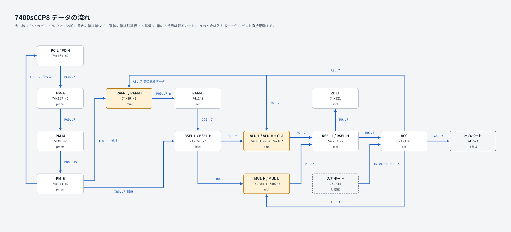

# 7400SeriesProcessor

7400 シリーズ汎用ロジック IC のコレクションを「動作するコレクション」として組み上げる、自作 8bit CPU **7400sCCP8**（7400-series Complete Collection Processor）の設計リポジトリ。
74x181（ALU）・74x182（桁上げ先見）・74x89（RAM）・74x284/74x285（乗算器）・74x141（ニキシー管ドライバ）などの希少な DIP IC に、CPU の中で実際の役割を与えて動かすことを目的とする。

- 設計の現状: **Phase 2（詳細設計）**。命令セットとシステム設計（IC の構成・制御信号・クロック位相・電気規格・基板構成）は決定済み。次はカードごとの回路設計で、実機・基板はまだ無い。
- 特徴: 役割（スロット）と実装（カード）を分離し、**手持ちの IC を可能な限り多種類使い、新しい型番が手に入ったらカード単位で構成を差し替えられる**ようにする。



1 命令を 4 位相で実行するアキュムレータ機。ALU は 74x181 × 2 + 74x182、データ RAM は 74x89 × 2、乗算は 74x284 + 74x285。
部品はすべて挿入部品で、TTM8 キットにならって LED で内部の信号を見せる。図の一覧は [`docs/design/images/`](docs/design/images/README.md)、設計の詳細は [`docs/design/SYSTEM.md`](docs/design/SYSTEM.md)。

## 構成

| パス | 内容 |
|---|---|
| `docs/REQUIREMENTS.md` | 目的・決定事項（D 番号）・未決事項・リスク・段階計画 |
| `docs/ARCHITECTURE.md` | データパス、スロット構成、命令セット |
| `docs/DESIGN_DOCS.md` | 回路図と解説（DR 資料）の規格 |
| `docs/design/` | システム設計（`SYSTEM.md`）、生成された全体図と一覧（`generated/`）、清書図（`images/`） |
| `hw/` | システムの正本（`system.json`）、スロット定義（`slots.json`）、カード定義（`cards/*/card.json`）、構成（`builds/*.json`）、74 シリーズ以外の部品（`parts_non74.json`）、生成された配線表・回路図 |
| `sim/` | IC 単位の動作モデル、命令レベルエミュレータ、アセンブラ、テスト（Python 標準ライブラリのみ） |
| `scripts/` | 全体図と一覧の生成（`gen_system.py`）、回路図生成（`gen_card.py`）、役割カバレッジ確認（`role_coverage.py`） |
| `collection/` | サブモジュール: [7400SeriesCollection](https://github.com/radiann-kswg/7400SeriesCollection)（非公開。チートシート・pinspec・データシート出典） |
| `structures/` | サブモジュール: [7400SeriesStructures](https://github.com/radiann-kswg/7400SeriesStructures)（回路構造資料） |

`collection/` は非公開リポジトリのため、権限が無い環境では取得できない。その場合も `sim/` と `docs/` は単独で読める・動く。
`collection/` 内の入れ子サブモジュール（`collection/structures`）は初期化しない（直下の `structures/` を使う）。

## 使い方

```sh
# テスト（リポジトリ直下で）
python -m unittest discover -s sim/tests -t .

# デモプログラム（13 × 11 を乗算器で計算し、BCD に直してニキシー表示ポートへ出力）
python -m sim.run sim/programs/mul_nixie.asm

# hw/system.json から全体図・IC 一覧・信号辞書を生成（--svg は mermaid-cli の mmdc が必要）
python scripts/gen_system.py

# カード定義から配線表と KiCad 回路図を生成（--svg / --erc は kicad-cli が必要）
python scripts/gen_card.py --all --svg --erc
```

Windows では `python3` ではなく `python` を使う。

## 注意

- ニキシー管は 170 V 級の高電圧を使う。表示基板と高圧電源はロジック基板から分離して設計する。
- 本リポジトリの回路・定数は検証途中のものを含む。`hw/cards/*/card.json` の `status` と、`docs/design/SYSTEM.md` の「カード設計で決めること」を確認すること。

## ライセンス

MIT License（`LICENSE`）。サブモジュールはそれぞれのライセンスに従う。データシートの本文・図表は含まない。
