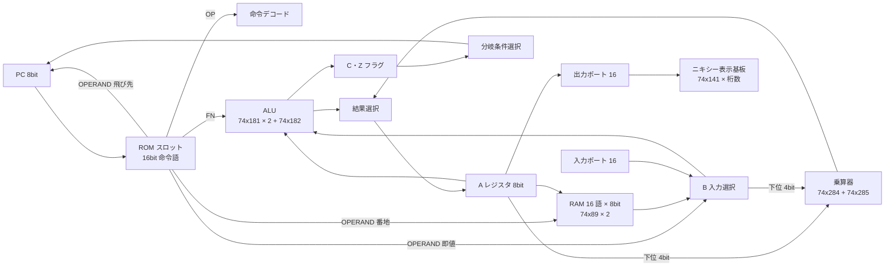

# アーキテクチャ草案（v0.1 / 2026-11-22）

> 設計案であり未承認の内容を含む。ピン番号・電気特性はここに書かない（pinspec と `hw/cards/*/WIRING.md` が担当）。
> IC の機能に関する記述は一般的な機能表の知識に基づくもので、一次資料との照合前（`docs/REQUIREMENTS.md` R1）。

## 1. 全体像

単一サイクル・ハーバード構成のアキュムレータ機。1 クロックで 1 命令を実行する。

希少 IC の役割:

| IC | 役割 | 外すと欠けるもの |
|---|---|---|
| 74x181 × 2 | 8bit ALU（下位・上位スライス） | すべての演算・ロード |
| 74x182 | 下位スライスの P・G から上位スライスへの桁上げを作る | 8bit の加減算 |
| 74x89 × 2 | データ RAM（下位・上位ニブル） | 変数の保持 |
| 74x284 + 74x285 | 4bit × 4bit の乗算（積 8bit を 1 命令で得る） | MUL 命令 |
| 74x141 × 桁数 | 出力ポートの BCD をニキシー管の陰極選択に変換 | 10 進表示 |

## 2. スロットとカード

役割は `hw/slots.json` に 36 個定義している（core 18 / peripheral 15 / panel 3）。
各役割は機能上の候補型番を持ち、実装は役割カードとして差し替える（`hw/README.md`）。

- core: ALU / CLA / MUL / RAM / REGFILE / ACC / PC / FLAGS / BSEL / RSEL / IDEC / COND / ZDET / GLUE / CLK / CLKDIV / STEP / ROM
- peripheral（I/O ポートに接続）: NIXIE / SEG7 / OUTPORT / INPORT / KEYENC / SEROUT / SERIN / SHIFTER / FIFO / PARITY / COMPARE / TIMER / SERARITH / IOBUS / IOSEL
- panel: BUSMON / LEDDRV / PANLATCH

周辺装置を I/O ポート（入力 16・出力 16）にぶら下げる形にしておくと、新しい型番は「ポートを 1 つ使う装置カード」として追加でき、core を作り直さずに済む。

## 3. 命令セット草案 v0.1

命令語 16bit: `[15:12] OP` / `[11:8] FN` / `[7:0] OPERAND`。符号化の正本は `sim/isa.py`。

| OP | 形式 | 動作 | フラグ |
|---|---|---|---|
| 0 / 1 | `LOGI fn, imm` / `LOGM fn, adr` | A ← 論理演算(fn; A, src) | Z |
| 2 / 3 | `ARNI` / `ARNM` | A ← 算術演算(fn; A, src)、桁上げ入力なし | C Z |
| 4 / 5 | `ARPI` / `ARPM` | 同上、桁上げ入力あり（+1） | C Z |
| 6 / 7 | `ARCI` / `ARCM` | 同上、桁上げ入力 = C フラグ | C Z |
| 8 / 9 | `TSTI` / `TSTM` | 算術演算(fn; A, src) + 1 のフラグだけ更新（A は不変） | C Z |
| A / B | `MULI imm` / `MULM adr` | A ← A[3:0] × src[3:0] | Z |
| C | `ST adr` | RAM[adr] ← A | — |
| D | `OUT port` | OUT[port] ← A（port は FN） | — |
| E | `IN port` | A ← IN[port] | Z |
| F | `JMP` / `JZ` / `JNZ` / `JC` / `JNC` / `HLT` | FN が条件（0 常時 / 1 Z / 2 NZ / 3 C / 4 NC / F 停止）、OPERAND が飛び先 | — |

- src は、偶数 OP では OPERAND（即値）、奇数 OP では RAM[OPERAND[3:0]]。
- FN は 74x181 の S3..S0 にそのまま渡す。74x181 の 16 論理機能・16 算術機能がすべて命令として使える。
- C は桁上げ出力（減算では「借りなし」で 1）。Z は結果が 0 のとき 1。

別名（アセンブラが展開する）:

| 別名 | 展開 | 別名 | 展開 |
|---|---|---|---|
| `LD` / `LDI` | LOG fn=1010（F = B） | `ADD` / `ADDI` | ARN fn=1001 |
| `AND` / `ANDI` | LOG fn=1011 | `SUB` / `SUBI` | ARP fn=0110 |
| `OR` / `ORI` | LOG fn=1110 | `ADC` / `ADCI` | ARC fn=1001 |
| `XOR` / `XORI` | LOG fn=0110 | `SBC` / `SBCI` | ARC fn=0110 |
| `NOT` | LOGI fn=0000 | `CMP` / `CMPI` | TST fn=0110 |
| `CLR` | LOGI fn=0011 | `INC` | ARPI fn=0000 |
| `NOP` | LOGI fn=1111 | `DEC` | ARNI fn=1111 |
| `SHL` | ARNI fn=1100（A + A） | `MUL` / `MULI` | OP A/B |

末尾 `I` が即値、無印が RAM 番地（0〜15）。

## 4. ハードウェア上の論点（Phase 2 で確定）

- **単一サイクルの成立条件**: ROM・RAM 読み出し・ALU・選択回路がすべて組み合わせ回路で、クロックの立ち上がりで A・PC・フラグを更新する。RAM への書き込みパルスはクロックの後半で作る。
- **ゼロ検出**: 74x181 の A=B 出力は F が全ビット H のときに出るもので、結果 0 の検出には使えない。8bit 比較器（ZDET スロット）で 0 と比較する案を第一候補とする。
- **RAM の反転出力**: 74x89 は記憶内容の反転を出力する。読み出し側で反転して戻す（A4）。
- **オープンコレクタ出力**: 74x89・74x284・74x285 の出力はプルアップが必要。値は速度とシンク電流から決める。
- **乗算結果の経路**: 乗算器の入力は A の下位 4bit と B 入力の下位 4bit。出力を B 入力側へ戻すと組み合わせループになるため、結果選択（RSEL）で A へ直接書き戻す。
- **右シフト**: 74x181 は右シフトを持たない。シフト装置（SHIFTER スロット）を周辺装置として追加する。
- **74x182 の使い方**: 2 スライス構成では 1 段分（下位の P・G と桁上げ入力から上位への桁上げ）だけを使う。未使用段の入力処理はデータシートに従う。

## 5. エミュレータ

`sim/machine.py` は `sim/ic74/` の IC モデルを実回路と同じつなぎ方で呼び出す（ALU は 74x181 × 2 と 74x182、RAM は 74x89 × 2、乗算は 74x284 + 74x285、表示は 74x141）。
構成を変えたら、対応する IC モデルを追加して組み立て部分を差し替える。

テストは、74x181 の機能表（論理 16・算術 16、桁上げ入力あり／なし）を全入力で突き合わせ、74x182 を通した桁上げが 74x181 自身の桁上げ出力と一致すること、8bit の加減算が全入力で正しいこと、デモプログラムが全 256 通りの乗算で正しい 10 進表示になることを確認する。
