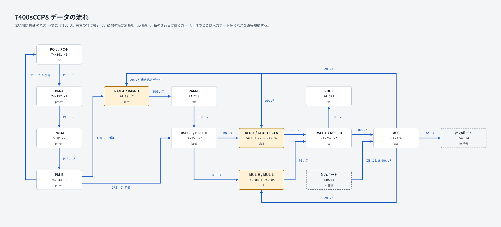
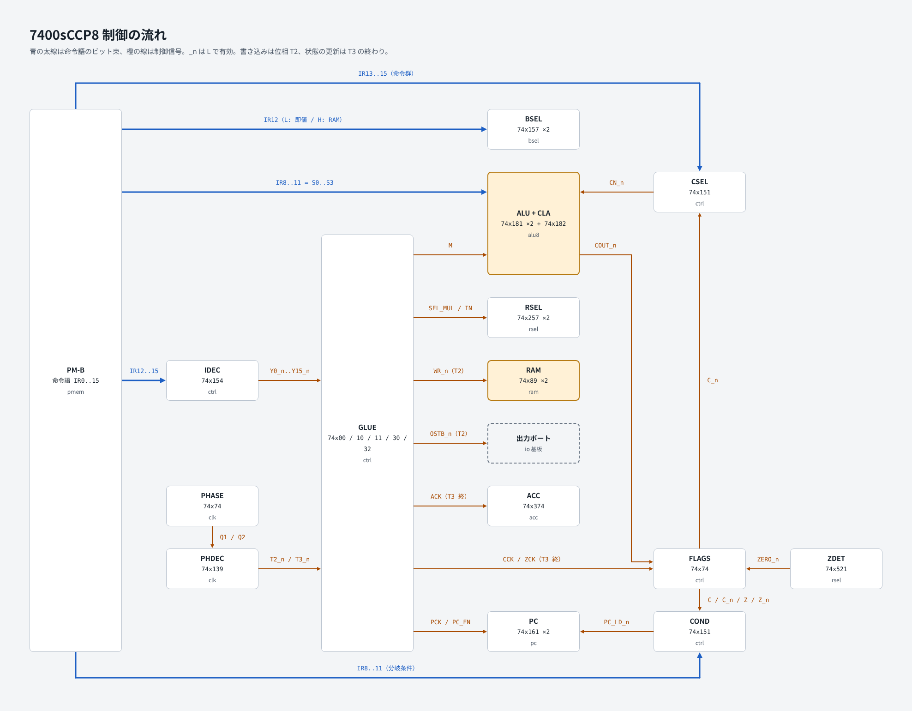
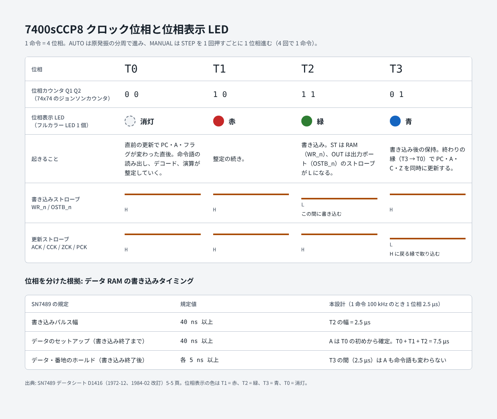
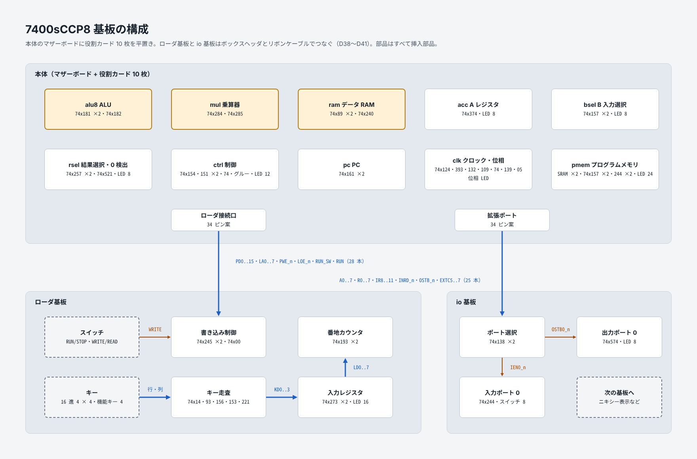
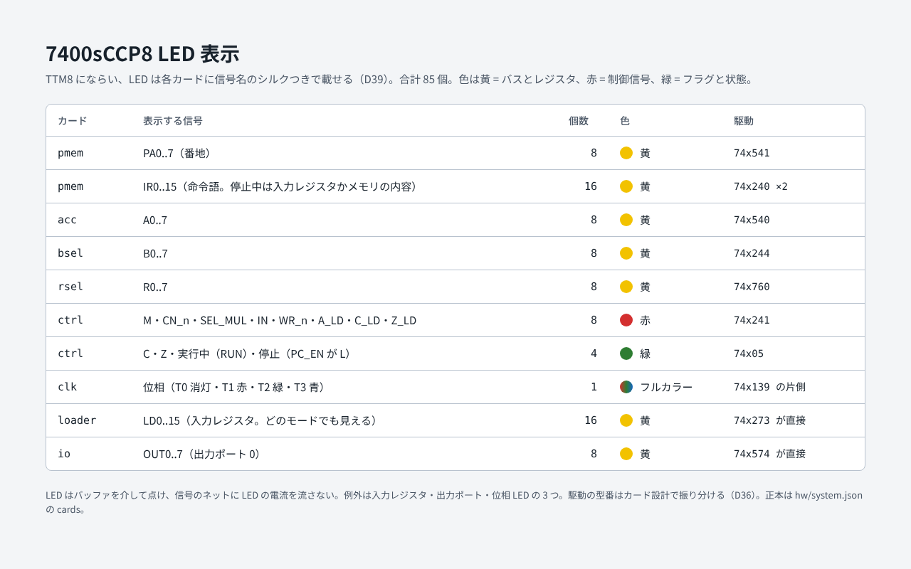

# 7400sCCP8 システム設計 — v0.3 / 2026-11-23

> システム設計は承認済み（`docs/REQUIREMENTS.md` の D30〜D46。決定の対応は 9 章）。
> ブロックと信号の正本は `hw/system.json`。全体図・IC 一覧・基板とカード・LED 一覧・接続口の信号数・信号辞書はそこからの生成物（[`generated/README.md`](generated/README.md)）で、この文書には写さない。
> 対象は第 1 弾（本体の core 10 枚、ローダ基板、io 基板）。ニキシー表示などの周辺装置は拡張ポートの先に足す。
> 数値の出典は 6.6 節。出典の無い素子の電気特性は書いていない（照合後に追記する）。
> 見やすさを優先した清書図は [`images/`](images/README.md) にある（Claude Design で作図して書き出したもの。正本と食い違ったら正本を正とする）。

## 1. 全体図

[`generated/README.md`](generated/README.md) の「全体図」。データの流れ、制御の流れ、クロック・位相・停止、ローダ基板、io 基板の 5 枚。
箱は IC（参照名・型番・載るカード）、太線は 2 本以上のバス。命令語は `IR12..15 = OP`、`IR8..11 = FN`、`IR0..7 = OPERAND`。

清書図（データの流れ・制御の流れ）:

## 2. IC 一覧

[`generated/README.md`](generated/README.md) の「IC 一覧」と「基板とカード」。74 シリーズの個数と種類の数は、その表の下に出る。
同じ役割に 2 個要る箇所は、ロジックファミリ違いの実型番を混ぜる（D36）。実型番は、構成（`hw/builds/default.json`）で決まっている役割はそこから引き、それ以外は電気的な要件が型番を決める箇所だけ `hw/system.json` に入れてある。残りはカード設計で振り分ける。

## 3. 信号辞書

[`generated/README.md`](generated/README.md) の「信号辞書」。「確定期限」は、その信号が正しい値に落ち着いていなければならない時点。
T2 の初めは書き込みに使う信号、T3 の終わりは状態の更新に使う信号。

## 4. 制御表

`Yk_n` は IDEC（74x154）の出力で、OP = k のときだけ L。`T2`・`T3` は 5 章の位相。

| OP | 命令 | B の元 | `M` | `CN_n` | R の元 | A 更新 | C 更新 | Z 更新 | T2 のストローブ | PC |
|---|---|---|---|---|---|---|---|---|---|---|
| 0 / 1 | LOGI / LOGM | 即値 / RAM | H | —（H） | F | ○ | | ○ | | +1 |
| 2 / 3 | ARNI / ARNM | 即値 / RAM | L | H（桁上げなし） | F | ○ | ○ | ○ | | +1 |
| 4 / 5 | ARPI / ARPM | 即値 / RAM | L | L（桁上げあり） | F | ○ | ○ | ○ | | +1 |
| 6 / 7 | ARCI / ARCM | 即値 / RAM | L | `C_n` | F | ○ | ○ | ○ | | +1 |
| 8 / 9 | TSTI / TSTM | 即値 / RAM | L | L | F | | ○ | ○ | | +1 |
| A / B | MULI / MULM | 即値 / RAM | — | — | P | ○ | | ○ | | +1 |
| C | ST | — | — | — | — | | | | `WR_n` | +1 |
| D | OUT | — | — | — | — | | | | `OSTB_n` | +1 |
| E | IN | — | — | — | 入力ポート | ○ | | ○ | | +1 |
| F | JP | — | — | — | — | | | | | 条件成立で IR7..0。FN = 5〜7 は分岐しない（予約）、IR11 = H で停止（D32） |

論理式:

| 信号 | 式 | 素子 |
|---|---|---|
| `Y0_n`〜`Y15_n` | IR15..12 の 1-of-16 デコード | 74x154 |
| B の選択 | `IR12`（L で即値、H で RAM） | 74x157 の選択入力へ直結 |
| `M` | NAND(`Y0_n`, `Y1_n`) | グルー |
| `CN_n` | 選択 = IR15・IR14・IR13、データ D0〜D7 = H, H, L, `C_n`, L, H, H, H | 74x151（表引き） |
| `SEL_MUL` | NAND(`Y10_n`, `Y11_n`) | グルー |
| `IN` | NOT(`Y14_n`) | グルー（RSEL の出力を切る） |
| `INRD_n` | NAND(`IN`, `T0_n`)。IN 命令の T1〜T3 だけ L | グルー（入力ポートの読み出し許可。io 基板へ） |
| `A_LD` | AND(`Y8_n`, `Y9_n`, `Y12_n`, `Y13_n`, `Y15_n`) | グルー |
| `C_LD` | NAND(`Y2_n`, …, `Y9_n`)（8 入力） | 74x30 |
| `Z_LD` | AND(`Y12_n`, `Y13_n`, `Y15_n`) | グルー |
| `WR_n` / `OSTB_n` | NAND(`T2`, NOT `Y12_n`) / NAND(`T2`, NOT `Y13_n`) | グルー |
| `PCK` / `ACK` / `CCK` / `ZCK` | NAND(`T3`, H) / NAND(`T3`, `A_LD`) / NAND(`T3`, `C_LD`) / NAND(`T3`, `Z_LD`) | 同じ型番・同じパッケージのゲートで作り、遅延を揃える |
| `PC_LD_n` | 選択 = IR10..8、データ D0〜D7 = H, `Z`, `Z_n`, `C`, `C_n`, `EXTC5`, `EXTC6`, `EXTC7`（未接続時は L）、ストローブ = OR(`Y15_n`, `IR11`)、反転出力 W を使う | 74x151（表引き） |
| `PC_EN` | NAND(NOT `Y15_n`, `IR11`) | グルー |

フラグの持ち方: C の D 入力に `COUT_n`、Z の D 入力に `ZERO_n` をそのまま入れ、Q を `C_n`・`Z_n`、反転出力を `C`・`Z` として使う（インバータが要らない）。リセットでプリセットして C = 0・Z = 0 にする。

## 5. クロック位相

2bit のジョンソンカウンタ（74x74 1 個。Q1・Q2）で 1 命令を 4 位相に分ける（D30）。状態が 1 ビットずつしか変わらないので、位相のデコードにひげが出ない。

| 位相 | Q1 Q2 | 位相 LED | 起きること |
|---|---|---|---|
| T0 | 0 0 | 消灯 | 直前の更新で PC・A・フラグが変わった直後。命令語の読み出しから ALU・乗算器・0 検出までが整定していく |
| T1 | 1 0 | 赤 | 整定の続き |
| T2 | 1 1 | 黄（赤 + 緑） | 書き込み。ST なら `WR_n`、OUT なら `OSTB_n` が L になる |
| T3 | 0 1 | 緑 | 書き込み後の保持時間。**T3 の終わり（T3 → T0）で PC・A・C・Z を同時に更新する** |

- `T2` = AND(Q1, Q2)、`T3` = AND(NOT Q1, Q2)。位相の展開は PHDEC（74x139）の片側で行う（`T0_n`・`T2_n`・`T3_n`）。
- 位相 LED は赤を Q1、緑を Q2 で、デコードを通さずに点ける（D29。駆動は 6.4 節の LED-PH）。色の意味は単色 LED と揃う: T1 の赤は制御信号が決まっていく段、T2 の黄はバス（RAM・出力ポート）へ書く段、T3 の緑はフラグと状態を更新する段。青は使わない。
- R バスの駆動の受け渡し: IN 命令では RSEL が出力を切り（`IN`。組み合わせ回路で命令に追従）、入力ポートは T1〜T3 だけ駆動する（`INRD_n`）。命令の切り替わりは T0 なので、RSEL と入力ポートが同時に R バスを駆動する期間ができない。
- 状態を持つ素子（PC・A・C・Z）はすべて T3 の終わりの 1 点で変わる。RAM と出力ポートは T2 で書く。
- HLT は PC の計数を止めるだけで、クロックは止めない（同じ HLT 命令を実行し続ける）。
- リセットは PC = 0、C = 0、Z = 0、位相 = T0、停止にする。A は不定のまま（D34）。

### 5.1 速度と手動ステップ（D29・D42）

- 原発振は SN74S124。ボリュームで周波数を連続に変え、スイッチで高速域と低速域を切り替える。その後ろの分周（74x393）のタップをジャンパで選ぶ。74S124 の発振範囲と制御入力はデータシートで照合し、合わなければジャンパだけにする。
- AUTO では分周出力で位相が進む。MANUAL では STEP を 1 回押すごとに 1 位相進む（4 回で 1 命令）。STEP と RESET のチャタリングは RC とシュミット入力（74x132）で取り、同じ IC で AUTO / MANUAL のクロックを切り替える。

### 5.2 停止とローダ（D40）

- RUN / STOP スイッチはローダ基板にある。本体の RUNSYNC（74x109）が、スイッチの状態を命令の切れ目（T3 の終わり）でだけ取り込んで `RUN` にする。RUNSYNC は位相カウンタと同じ `CK4` で動き、取り込みを許すのは「現在 T3」か「停止中」のとき。停止中は位相が T0 に留まるので、RUN に戻した次の `CK4` で動き出す。
- `RUN` が L の間、位相は T0 に留まり、プログラムメモリの番地はローダ側に切り替わる。STOP に倒しても、実行中の命令は T3 の終わりまで続く。MANUAL のときは、位相 LED が消灯するまで STEP を押せば止まる。
- ローダの許可条件は `RUN` が L であること。`RUN` は命令の切れ目でしか L にならないので、「停止中かつ T0」が自動的に満たされる。許可は書き込み（`PWE_n`・`LOE_n`）だけでなく、キーの取り込み（`KSTB`）と番地の操作（AS・UP・DN）にも掛ける。
- リセットは RUNSYNC も停止にする（D34 の補足）。解除後の最初の `CK4` で RUN/STOP スイッチの状態を取り込むので、スイッチが RUN なら PC = 0 から動き出す。

ローダの操作（TTM8 のプログラムボードにならう）:

| 操作 | 動作 |
|---|---|
| RUN/STOP を STOP | 命令の切れ目で止まり、番地がローダ側に切り替わる |
| 16 進キー | 入力レジスタ（16bit）を 4bit 桁送りし、押した値を最下位に入れる。キーは 4 × 4 の行列を走査して読む |
| AS（番地設定） | 入力レジスタの下位 8bit を番地カウンタへロードする |
| WI（WRITE モード） | 押している間、入力レジスタの内容をその番地へ書き込む。離すと番地 +1 |
| RI / RD | 離すと番地 +1 / −1 |
| 表示 | 本体の番地 LED はプログラムメモリの番地、命令語 LED は WRITE モードで入力レジスタ、READ モードでメモリの内容、実行中は実行中の命令語。ローダ基板の LED 16 個は、どのモードでも入力レジスタ |

キーの行列走査（D40）: 計数器（74x93）が走査位置を数え、上位 2bit で行（74x156。オープンコレクタなので 2 つ同時に押しても出力どうしがぶつからない）、下位 2bit で列（74x153）を選ぶ。押されたキーの位置で計数が止まり、その値がキーの番号になる。押され続けたことを単安定（74x221）で確かめてから 1 回だけ入力レジスタへ取り込む。機能キー 4 個は行列に入れず、RC とシュミット入力（74x14）で個別に受ける。

### 5.3 74x89 の書き込みタイミング

74x89 の規定値との対応（原発振の 4 分周が 1 命令。常用上限 100 kHz で 1 位相 = 2.5 µs）:

| 規定（SN7489） | 値 | 本設計 | 余裕 |
|---|---|---|---|
| 書き込みパルス幅 | 40 ns 以上 | T2 の幅 = 2.5 µs | 60 倍 |
| データのセットアップ（書き込み終了まで） | 40 ns 以上 | A は T0 の初めから確定。T0 + T1 + T2 = 7.5 µs | 十分 |
| データ・番地のホールド（書き込み終了後） | 各 5 ns 以上 | T3 の幅 = 2.5 µs の間、A と IR は変わらない | 十分 |
| 番地のセットアップ（書き込み開始まで） | 0 ns 以上 | IR は T0 で確定、書き込みは T2 から | 十分 |

位相を分けた理由: 単相クロックの後半を書き込みパルスにすると、書き込みの終わりと PC の更新が同じ縁になり、5 ns のホールドを素子の遅延頼みで満たすことになる。T3 を挟めば設計で保証できる。

整定時間（T0 + T1 = 5 µs の内訳）は、照合済みの素子だけで RAM 読み出し 60 ns、ALU の A・B → F が 22〜34 ns（桁上げ先見経由）、乗算器 60 ns（いずれも最大値）。未照合の素子（PMEM、バッファ、選択、0 検出）を含めた合計は 2 段目の照合後に表にする。

## 6. 電気規格

### 6.1 カード境界（D13・D33）

- 5 V 単電源。信号は正論理・TTL レベル（受け側は VIH 2.0 V・VIL 0.8 V で判定できること）。
- TTL 出力を HC 入力で受ける箇所は、受けるカードの中でプルアップするか、TTL 入力の素子（LS / ALS / AS / F / HCT / ACT / ABT）を使う。
- オープンコレクタ出力（74x89・74x284・74x285）のプルアップは、その IC が載るカードの中に置く。
- 例外: プログラムメモリの SRAM（AS6C62256・AS6C6264）は入力の VIH が最小 2.4 V で、TTL 出力の VOH 最小 2.4 V と余裕が無い。SRAM の番地・制御線は CMOS 出力の素子（HCT・ACT など）で駆動する。SRAM の出力（IOL 2 mA）は重い負荷を直接駆動しない。
- 「何本まで駆動できるか」は一律の本数で決めず、ネットごとに受け側の入力電流を合計して駆動側の IOL・IOH と比べる（6.2 節）。

### 6.2 重い負荷（SN74S181・SN74S182 の入力電流による）

| ネット | 受け側 | L レベルで吸い込む電流の合計 | H レベルで流し出す電流の合計 |
|---|---|---:|---:|
| `IR8..11`（S0..S3）の各線 | 74S181 × 2 の S 入力 | 16 mA | 400 µA |
| `M` | 74S181 × 2 の M 入力 | 4 mA | 100 µA |
| `CN_n` | 74S181（下位）の Cn + 74S182 の Cn | 12 mA | 300 µA |
| `A0..3` の各線 | 74S181 の A + 74284 + 74285 + 7489 のデータ入力 | 9.6 mA | 270 µA |
| `A4..7` の各線 | 74S181 の A + 7489 のデータ入力 | 7.6 mA | 190 µA |
| `B0..3` の各線 | 74S181 の B + 74284 + 74285 | 8 mA | 230 µA |
| `B4..7` の各線 | 74S181 の B | 6 mA | 150 µA |
| `IR0..3` の各線 | 7489 × 2 の番地入力（ほかに BSEL・PC） | 3.2 mA + α | 80 µA + α |

A バスには出力ポートの入力電流がさらに加わる。

ここから決まること:

- `IR8..11` を駆動する PM-B は、IOL 16 mA を超える余裕が要る。SRAM の出力を直接つなげない。
- `CN_n` を作る CSEL は IOL 12 mA 以上が要る。満たせない型番なら駆動用のゲートを 1 段足す。
- ACC・BSEL は TTL 入力で IOL 12 mA 級以上の素子にする（採用案の SN74ALS374A などは 2 段目で数値を照合する）。
- A バスの LED は LED-A（バッファ）を介して点け、A バスの負荷にはバッファの入力 1 つ分だけが加わる（6.4 節）。
- ALU カードの内部（74S181 の出力 IOL 20 mA）は、P → CLA の P0 が 8 mA、G → G0 が 14 mA、CLA の Cn+x → 上位の Cn が 10 mA で、いずれも収まる。

### 6.3 電源電流（希少 IC 9 個の分）

| IC | 個数 | 代表 | 最大 |
|---|---:|---:|---:|
| SN74S181 | 2 | 120 mA × 2 | 220 mA × 2 |
| SN74S182（出力 L 時） | 1 | 69 mA | 109 mA |
| SN7489 | 2 | 75 mA × 2 | 105 mA × 2 |
| SN74284 / SN74285 | 各 1 | 92 mA × 2 | 130 mA × 2 |
| 合計 | 9 | 643 mA | 1,019 mA |

残りの素子を足すと 5 V 電源は 2 A 級を見込む（確定値は全素子の照合後）。

### 6.4 LED の駆動（D39）

- LED は原則としてバッファ（各カードの LED-xx ブロック）を介して点け、信号のネットには LED の電流を流さない。重い負荷のネット（6.2 節）でも、バッファの入力 1 つ分しか増えない。
- 例外は 2 つ。入力レジスタ（ローダ基板の 74x273）は受け側が軽いので出力で直接点ける。出力ポート（SN74ABT574A）は出力が強く、LED を点けることが役目なので直接点ける。
- 位相 LED も原則どおり、clk カードの LED-PH（オープンコレクタの反転）で点ける。Q2 の反転出力はジョンソンカウンタの帰還に使うので、そこに LED の電流を流さない。
- 抵抗は TTM8 にならって集合抵抗を使う。LED 1 個あたりの電流、抵抗値、色ごとの順方向電圧はカード設計で決める。
- 全部点いたときの LED の電流は、1 個 3 mA として LED 一覧の全数で約 260 mA。電源の見積もりに含める。

### 6.5 電源（D43）

- DC ジャックと 5 V の AC アダプタ。TTM8 の USB-B 給電（1 A 以下）より大きい電流を見込む。
- 見積もり: 希少 IC 9 個は 6.3 節の合計、LED は 6.4 節。残りの素子は 2 段目の照合で足す。アダプタは 2 A 級を想定し、合計が出てから決める。
- パスコンは IC ごとに 0.1 µF、カードごとと基板の電源入口に電解コンデンサを置く（TTM8 の部品構成と同じ考え方）。値はカード設計で決める。

### 6.6 出典（2026-11-23 に PDF を目視。読み取り信頼度はいずれも 95%）

| 素子 | DocID・頁 | 引いた値 |
|---|---|---|
| SN74S181 | SDLS136（1972-12、1988-03 改訂）8 頁・9 頁 | IIL: M −2 mA、A・B −6 mA、S −8 mA、Cn −10 mA。IIH: 50 / 150 / 200 / 250 µA。IOL 20 mA、IOH −1 mA。ICC 代表 120 mA・最大 220 mA。遅延（最大）: A・B → F 22 ns、A・B → G・P 15 ns、Cn → F 12 ns |
| SN74S182 | SDLS206（1972-12、1988-03 改訂）4 頁 | IIL: Cn −2 mA、P0 −8 mA、G0 −14 mA（ほか P1 −8、P2 −6、P3 −4、G1 −16、G2 −14、G3 −8 mA）。IOL 20 mA。ICCH 代表 35 mA・最大 70 mA、ICCL 代表 69 mA・最大 109 mA。遅延（最大）: P・G → Cn+x 7 ns、Cn → Cn+x 10.5 ns |
| SN7489 | D1416（1972-12、1984-02 改訂）5-3 頁・5-5 頁・5-6 頁 | 機能表（書き込み中の出力はデータ入力の反転）。書き込みパルス幅 40 ns、データのセットアップ 40 ns・ホールド 5 ns、番地のセットアップ 0 ns・ホールド 5 ns。IIL −1.6 mA、IIH 40 µA、VOL 0.4 V（IOL 12 mA）、ICC 代表 75 mA・最大 105 mA。番地 → 出力 最大 60 ns |
| SN74284 / SN74285 | TI の資料（1972-05、1983-12 改訂。DocID の記載なし）3-925 頁 | IIL −1 mA、IIH 40 µA、IOL 16 mA、出力耐圧 5.5 V。ICC 代表 92 mA・最大 130 mA。語入力 → 出力 最大 60 ns |
| AS6C62256-55PCN | Alliance Memory AS6C62256 Rev 1.2（2016-03-23）2〜4 頁・7 頁・11 頁 | 2.7〜5.5 V、600 mil PDIP。VIH 最小 2.4 V・VIL 最大 0.6 V、VOH 2.4 V（−1 mA）・VOL 0.4 V（2 mA）。tAA 55 ns、tOE 30 ns、tWP 45 ns、tDW 25 ns、tAS・tWR・tDH 0 ns。ICC 最大 45 mA。データ保持 1.5 V 以上（CE# ≥ VCC − 0.2 V）、IDR 最大 20 µA |
| AS6C6264-55PCN | Alliance Memory AS6C6264 v2.0（2017-07）2〜4 頁・7 頁・11 頁 | 62256 と同じ電圧・タイミング。1 番 NC、26 番 CE2（H で選択）。データ保持は CE# ≥ VCC − 0.2 V または CE2 ≤ 0.2 V、IDR 最大 10 µA |

## 7. 基板構成と LED（D38〜D41）

### 7.1 基板

基板ごとの中身とつなぎ方は [`generated/README.md`](generated/README.md) の「基板とカード」と「基板をまたぐ信号」（正本は `hw/system.json` の boards と signals）。ここには、そう分けた理由と、表に出ない決まりだけを書く。

- 本体とローダ基板・io 基板は、TTM8 の本体とプログラムボードにならってリボンケーブルでつなぐ。操作面（キー・スイッチ）を手前に置け、高圧を使う表示基板もロジックから離せる（D4・D40・D41）。
- 部品はすべて挿入部品で手はんだし、PCBA は使わない。IC は全数ソケットに挿す（D38）。
- 接続口は、基板をまたぐ信号の本数に電源と GND を足して、どちらも 34 ピンのボックスヘッダを案とする。
- R バスは拡張ポートを通って io 基板の入力ポートからも駆動される（D31）。どこも駆動しないときの FF は、rsel カードのプルアップで作る。
- 拡張ポートには、JP の外部条件 `EXTC5..7`（D32）も出す。プルダウンは本体（ctrl カードの COND の入力）に置き、io 基板を外しても L で分岐しない。

### 7.2 TTM8 にならった点

| TTM8 | 本機 |
|---|---|
| 本体とプログラムボードの 2 枚。部品はすべてスルーホール | 本体（+ 役割カード）、ローダ基板、io 基板。部品はすべて挿入部品 |
| LED はレジスタやユニットの近くに付き、信号名で読む | LED を各カードに載せ、信号名をシルクで入れる（D39） |
| LED は 3 色（黄・赤・緑）、抵抗は集合抵抗 | 黄 = バスとレジスタ、赤 = 制御信号、緑 = フラグと状態。位相はフルカラー。抵抗は集合抵抗 |
| プログラムボード: 16 進キー、AS・RI・RD・WI、START/STOP、WRITE/READ | 同じ操作体系。表示は 7 セグではなく 2 進 LED（D25） |
| 拡張ポートに外部レジスタの基板を数珠つなぎ | 拡張ポートに io 基板やニキシー表示基板を数珠つなぎ（D41） |
| プログラムボードはマイコンで動く | ローダも 74 シリーズだけで組む（D23） |

### 7.3 LED

表示する範囲は D39、一覧（カード・信号・色・駆動）は [`generated/README.md`](generated/README.md) の「LED 一覧」。

## 8. 検証記録

| 日付 | 内容 | 結果 |
|---|---|---|
| 2026-11-23 | `scripts/gen_system.py` の検査（ブロックと信号の端点、カードと基板、LED の参照、複数駆動の宣言） | ブロック 52・信号 64、警告 0 |
| 2026-11-23 | 4 章の論理式を信号レベルのモデル（`sim/structural.py`）に組み、`sim/machine.py` と 1 命令ごとに PC・A・C・Z・RAM・出力ポートを比較（`sim/tests/test_structural.py`。乱数プログラム 150 本、全 16 OP、JP の予約・停止を含む）。位相はモデル化しておらず、1 命令の中の「書き込みのあとで更新」の順序だけを再現している。位相とストローブのタイミングは 5 章の表と素子の規定値で確かめる | 論理式は一致 |
| 2026-11-23 | 同じ比較を乱数プログラム 400 本・231,810 命令で実施（使い捨てのスクリプト） | 一致 |
| 2026-11-23 | D29 の改訂（位相 LED を Q1 = 赤・Q2 = 緑で点け（デコードなし）、駆動に LED-PH を追加）のあとで `scripts/gen_system.py` の検査 | ブロック 53・信号 64、警告 0 |

## 9. 決定の記録

2026-11-23 の質疑で、確認事項 S1〜S15 を次のとおり決めた。

| 確認事項 | 決定 |
|---|---|
| S1 クロック方式 / S11 A レジスタ | D30 |
| S2 IN の経路 | D31 |
| S3 JP の FN | D32 |
| S4 RAM の反転を戻す場所 | D33 |
| S5 リセット時の A | D34 |
| S6 REGFILE | D35 |
| S7 第 1 弾の範囲 | D27 |
| S8 カードの割り方 | D28（ローダと入出力は別基板。D40・D41） |
| S9 手動ステップ | D29 |
| S10 同じ型番の振り分け | D36 |
| S12 キーの読み取り | D40（行列走査） |
| S13 入力レジスタと番地カウンタ | D40（74x273 × 2 の桁送り、74x193 × 2） |
| S14 LED 表示の範囲 | D39（入力レジスタ専用 LED と内部の LED も含める） |
| S15 第 1 弾の規模と予算 | D38・D44 |

## 10. カード設計で決めること

システム設計では決めず、各カードの設計（`docs/DESIGN_DOCS.md` の 2〜3 段目）で一次資料を見ながら決める。

1. 新しく使う型番の pinspec と電気特性（[`generated/README.md`](generated/README.md) の「pinspec の無い型番」）。
2. 実型番の振り分け（D36）と、グルー論理のゲート割り付け。
3. 駆動力とレベルの確かめ: PM-B が `IR8..11`（16 mA）を、CSEL が `CN_n`（12 mA）を駆動できるか（6.2 節）。足りなければ駆動用のゲートを足す。HC 入力の素子（IDEC の CD74HC154 など）が TTL 出力を受ける箇所は、駆動側を CMOS 出力にするかプルアップを置く（6.1 節）。
4. プルアップ・プルダウンの値: RAM の出力、乗算器の出力、R バス、キーの列、`EXTC5..7`。
5. LED の電流・抵抗値・色ごとの順方向電圧（6.4 節）。位相 LED はアノード共通のフルカラー LED にして、LED-PH の出力で赤（`PH_R_n` = NOT Q1）と緑（`PH_G_n` = NOT Q2）のカソードを引く。青のカソードは未接続。T2 の黄は赤と緑の電流比で色味が変わるので、抵抗値は実物で見て決める。PHDEC の空いた片側の扱い（入力を固定するか、別の用途に回すか）も決める。オープンコレクタや反転のバッファ（74x760・74x05 など）で点ける LED は、信号が H のときに点くか L のときに点くかをカードごとに決め、シルクに書く（`PC_EN` は L で点灯して「停止」を示す）。
6. キー走査の周波数と、押され続けたと判定する時間。機能キーと STEP・RESET の RC の時定数。WI を離したときは、書き込みパルス（`PWE_n`）が H に戻ってから番地を +1 する（同じ縁で両方を動かすと、SRAM の番地の保持時間を素子の遅延頼みで満たすことになる）。
7. 74S124 の発振範囲と制御電圧（D42）。AUTO / MANUAL を切り替えるときにクロックにひげを出さない方法。
8. SRAM は AS6C62256 と AS6C6264 の両方を照合済み（`hw/parts_non74.json`、pinspec あり）。決めること: どちらを使うか、26 番を「電源正常で H」・1 番を GND にして両方を挿せるようにするか、電池バックアップの回路（電源断のときにチップを非選択に保つ方法。6264 なら CE2 を L、62256 なら CE# を VCC − 0.2 V 以上）、電池、逆流防止。
9. 各カードとマザーボードのコネクタの信号並び、ローダ接続口と拡張ポートのピン配置。リボンケーブルの接続口は信号線の間に GND を挟む（`reg8_574` の暫定 20 極は GND が 1 本だけで、回路図の解析で指摘された）。
10. 電源アダプタの容量（6.5 節）。
11. 生成器（`scripts/gen_card.py`）の拡張: 部品ごとに実型番（MPN）とデータシートの属性を回路図へ書く、IC ごとのパスコンなどの受動部品を載せる。今の回路図は実型番の属性もパスコンも持たず、回路図の解析ではデータシートとの照合ができない（DS-001）・パスコンが無い（DO-DET）と指摘される。
12. RAM の 2 個目の実型番。D36 に従えばファミリ違いにするが、手元で使える 16 語 × 4bit の RAM は 74x89 と 74x189（3 ステートの反転出力）で、機能もピンも同じとは限らない。74x189 の pinspec を照合してから、2 個とも SN7489 にするか、上位を 74x189 にするか決める（D16 は上下で型番を変えてよい）。

2026-11-23 のレビュー（ディジタル回路・データ整合性の観点）で挙がった実機のリスク。カード設計で確かめるか、対策を決める。

13. T3 の終わりの保持時間。ARC 命令では C の Q → CSEL → 74S181 の Cn → F → R バス → A の D の経路があり、`CCK` と `ACK` は同じ縁で動く。`CCK` が `ACK` より先に来ると、A が新しい C で計算し直した値を取り込むおそれがある。今の根拠は「同じパッケージのゲートで遅延を揃える」（4 章）だけで、最小遅延は規定値が無い。経路の最小遅延と 74x374 のホールド時間で余裕を確かめる。IN 命令で入力ポートが R バスを手放す時刻と `ACK` の関係も同じく確かめる（R バスのプルアップの値が効く）。PHDEC の出力は `T2_n`・`T3_n` なので、4 本の更新ストローブは同じ構成（例: OR(`T3_n`, NOT X)）で作る。
14. 出力ポートのクロックのひげ。`reg8_574` の暫定接続口（9 項）では A バス 8 本と `OSTB_n` が GND 1 本のケーブルを通る。T3 の終わりに A が 8 本同時に変わると、クロストークやグラウンドの跳ねで `OSTB_n` にひげが出て、新しい A を誤って取り込むおそれがある。信号線の間に GND を挟むことに加えて、受け側のクロックにシュミット入力か RC を入れるか決める。`reg8_574` の `OE_n` はカードの中にプルダウンが無く、接続口で駆動しないと浮く。
15. 6.2 節の重い負荷の表の漏れ。IDEC（CD74HC154。HC 出力で IOL 4 mA 級）の `Y15_n` は A_LD・Z_LD・COND のストローブ・`PC_EN` の 4 入力、`Y12_n`・`Y13_n` は 3 入力ずつを駆動する。グルーに標準 TTL や S を選ぶと足りない。`IR8..11` の「+α」（COND の選択、io 基板のポートのデコード、命令語 LED のバッファ）も表に足す。`CN_n` の H 側に含めた 74S182 の Cn の IIH 50 µA は 6.6 節に出典が無いので、照合して載せる。
16. 生成器の検査の抜け。`scripts/gen_system.py` は `hw/slots.json` を読まず、役割の個数・候補と配置した IC の対応を検査していない（例: MUL は個数 1 だが 74284 と 74285 の 2 個、BSEL・RSEL・GLUE・PMEM も個数が合わない。DEB の 74x132 と LED-CTL の 74x241 はどの役割の候補にも無い）。`scripts/gen_card.py` は入力ピンの未接続（NC）と、同じ参照名の部品の重複を警告しない。11 項の拡張と合わせて直す。

カードを設計する順番は、希少 IC を載せる `alu8` から始める。
