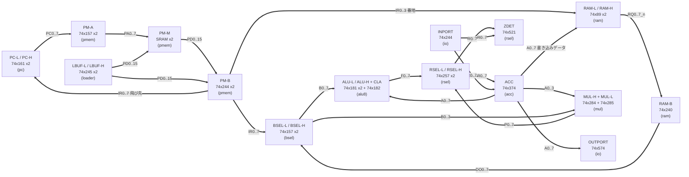
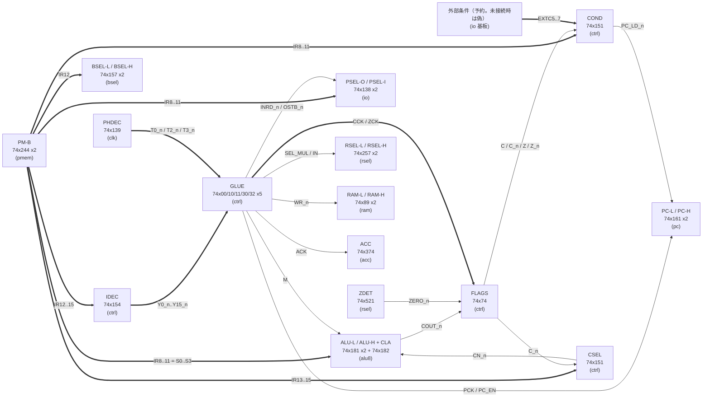
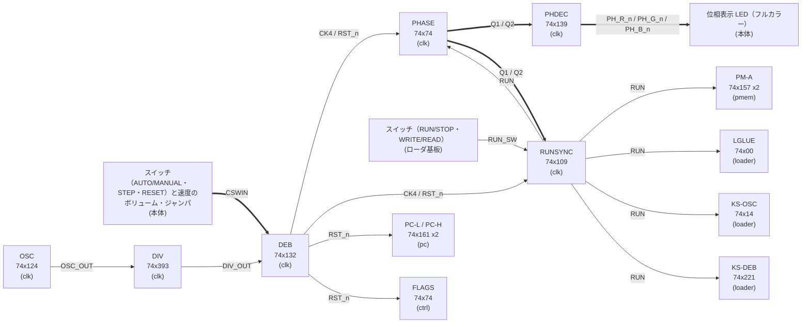
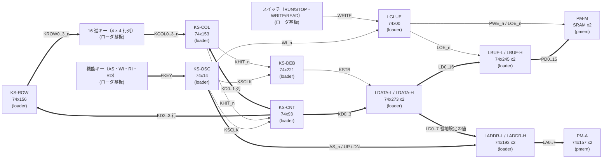
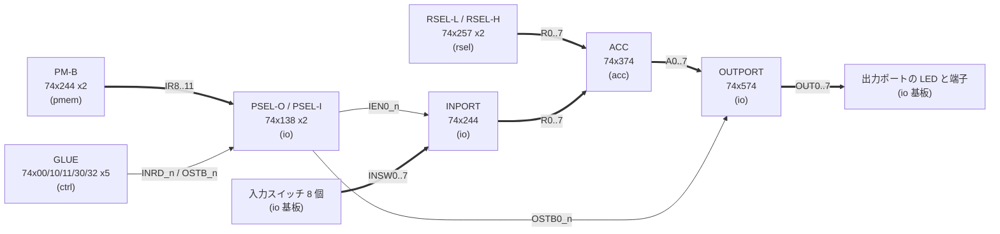

# システム階層の生成物

> `scripts/gen_system.py` による生成物。手で編集せず `hw/system.json` を直して再生成する。

- 正本: `hw/system.json`（版 0.3-draft）。実型番は `hw/builds/default.json` から引く
- 解説: [`../SYSTEM.md`](../SYSTEM.md)
- 電源: DC ジャック + 5 V の AC アダプタ（D43）。アダプタの容量は全素子の消費電流を照合してから決める。見積もりは docs/design/SYSTEM.md の 6.3〜6.5 節

## 全体図

### データの流れ

太線は 2 本以上のバス。

SVG: [`fig_data.svg`](fig_data.svg)

### 制御の流れ

IR8..11 と IR12..15 は命令語の FN と OP。ストローブの位相は docs/design/SYSTEM.md の 5 章。

SVG: [`fig_ctrl.svg`](fig_ctrl.svg)

### クロック・位相・停止

clk カード。RUN はローダ基板の RUN/STOP スイッチから来る。

SVG: [`fig_clock.svg`](fig_clock.svg)

### ローダ基板

キーの行列走査、入力レジスタ、番地カウンタ、書き込みの許可。

SVG: [`fig_loader.svg`](fig_loader.svg)

### io 基板

拡張ポートの先。出力ポート 0 と入力ポート 0。

SVG: [`fig_io.svg`](fig_io.svg)

## IC 一覧

| 参照 | 汎用型番 | 個数 | 採用実型番 | 役割 | カード | 基板 | 外すと欠ける機能 | pinspec |
|---|---|---:|---|---|---|---|---|---|
| ALU-L / ALU-H | 74x181 | 2 | SN74S181NC | 8bit ALU の下位・上位スライス | `alu8` | 本体 | すべての演算とロード | 有 |
| CLA | 74x182 | 1 | SN74S182N | 下位スライスの P・G から上位スライスへの桁上げを作る | `alu8` | 本体 | 8bit の加減算 | 有 |
| MUL-H | 74x284 | 1 | SN74284N / SN74285N | 積の上位 4bit | `mul` | 本体 | MUL 命令 | 有 |
| MUL-L | 74x285 | 1 | SN74284N / SN74285N | 積の下位 4bit | `mul` | 本体 | MUL 命令 | 有 |
| RAM-L / RAM-H | 74x89 | 2 | SN7489N | データ RAM 16 語 × 8bit | `ram` | 本体 | 変数の保持 | 有 |
| RAM-B | 74x240 | 1 |  | RAM の反転出力を正論理に戻し、DO バスを駆動する（D33） | `ram` | 本体 | RAM の読み出し | 無 |
| ACC | 74x374 | 1 | SN74ALS374A | A レジスタ。A バスを駆動する（D30） | `acc` | 本体 | 演算の左辺と結果の保持 | 有 |
| BSEL-L / BSEL-H | 74x157 | 2 |  | B 入力を即値（IR0..7）と RAM（DO）から選ぶ | `bsel` | 本体 | 即値とメモリの使い分け | 無 |
| RSEL-L / RSEL-H | 74x257 | 2 |  | 結果を ALU（F）と乗算器（P）から選んで R バスへ出す。IN のときは出力を切る（D31） | `rsel` | 本体 | MUL の結果、IN | 無 |
| ZDET | 74x521 | 1 | SN74ALS521 | R バスが 0 かを検出する | `rsel` | 本体 | Z フラグ、JZ / JNZ | 無 |
| IDEC | 74x154 | 1 | CD74HC154 | OP を 16 本の L アクティブ信号に展開する | `ctrl` | 本体 | 全命令の制御 | 無 |
| CSEL | 74x151 | 1 |  | 命令群ごとに ALU の桁上げ入力（なし／あり／C フラグ）を選ぶ | `ctrl` | 本体 | SUB・INC・ADC・SBC・CMP | 無 |
| FLAGS | 74x74 | 1 |  | C フラグと Z フラグ | `ctrl` | 本体 | 条件分岐、多倍長演算 | 有 |
| COND | 74x151 | 1 |  | FN で指定した分岐条件を選び、PC のロードを決める（D32） | `ctrl` | 本体 | JMP と条件分岐 | 無 |
| GLUE | 74x00 / 74x10 / 74x11 / 74x30 / 74x32 | 約 5 |  | 制御信号の合成と、書き込み・更新ストローブ（ゲートの割り付けと個数はカード設計で確定する） | `ctrl` | 本体 | 各制御信号 | 一部有 |
| PC-L / PC-H | 74x161 | 2 |  | プログラムカウンタ 8bit（計数・ロード・クリア） | `pc` | 本体 | 命令の順次実行と分岐 | 無 |
| OSC | 74x124 | 1 | SN74S124 | 原発振。制御電圧で周波数を変えられる（D42。仕様は照合待ち） | `clk` | 本体 | 自動実行 | 無 |
| DIV | 74x393 | 1 |  | 分周。タップをジャンパで選ぶ（D42） | `clk` | 本体 | 速度の選択 | 無 |
| DEB | 74x132 | 1 |  | STEP・RESET のチャタリング除去（RC + シュミット入力）と、AUTO / MANUAL のクロック切り替え（ゲートの割り付けはカード設計で確定する） | `clk` | 本体 | 手動ステップ、リセット | 無 |
| RUNSYNC | 74x109 | 1 |  | RUN / STOP を命令の切れ目（T3 の終わり）でだけ切り替える（D40） | `clk` | 本体 | 命令の途中で止めない停止 | 無 |
| PHASE | 74x74 | 1 |  | 2bit ジョンソンカウンタで 1 命令を 4 位相に分ける（D30） | `clk` | 本体 | 書き込みと更新のタイミング | 有 |
| PHDEC | 74x139 | 1 |  | 位相 Q1・Q2 を T0〜T3 に展開する。片側は制御用、片側は位相 LED の駆動用（D29） | `clk` | 本体 | 書き込み・更新ストローブ、位相表示 | 無 |
| PM-A | 74x157 | 2 |  | プログラムメモリの番地を PC（実行中）とローダ（停止中）で切り替える | `pmem` | 本体 | プログラムの書き込み | 無 |
| PM-M | SRAM | 2 |  | 16bit × 256 語のプログラム記憶。電池バックアップ（D24・D37）（74 以外（D8）。候補は hw/parts_non74.json） | `pmem` | 本体 | プログラムの保持 | — |
| PM-B | 74x244 | 2 |  | 命令語を IR バスへ駆動する（FN 線は 74S181 2 個分の負荷） | `pmem` | 本体 | 命令の供給 | 有 |
| LED-PA | 74x541 | 1 |  | LED の駆動。信号の負荷を増やさないよう、LED はバッファを介して点ける（型番の振り分けはカード設計で決める（D36）） | `pmem` | 本体 | そのカードの LED 表示 | 無 |
| LED-IR | 74x240 | 2 |  | LED の駆動。信号の負荷を増やさないよう、LED はバッファを介して点ける（型番の振り分けはカード設計で決める（D36）） | `pmem` | 本体 | そのカードの LED 表示 | 無 |
| LED-A | 74x540 | 1 |  | LED の駆動。信号の負荷を増やさないよう、LED はバッファを介して点ける（型番の振り分けはカード設計で決める（D36）） | `acc` | 本体 | そのカードの LED 表示 | 無 |
| LED-B | 74x244 | 1 |  | LED の駆動。信号の負荷を増やさないよう、LED はバッファを介して点ける（型番の振り分けはカード設計で決める（D36）） | `bsel` | 本体 | そのカードの LED 表示 | 有 |
| LED-R | 74x760 | 1 |  | LED の駆動。信号の負荷を増やさないよう、LED はバッファを介して点ける（型番の振り分けはカード設計で決める（D36）） | `rsel` | 本体 | そのカードの LED 表示 | 無 |
| LED-CTL | 74x241 | 1 |  | LED の駆動。信号の負荷を増やさないよう、LED はバッファを介して点ける（型番の振り分けはカード設計で決める（D36）） | `ctrl` | 本体 | そのカードの LED 表示 | 無 |
| LED-FLG | 74x05 | 1 |  | LED の駆動。信号の負荷を増やさないよう、LED はバッファを介して点ける（型番の振り分けはカード設計で決める（D36）） | `ctrl` | 本体 | そのカードの LED 表示 | 無 |
| KS-OSC | 74x14 | 1 |  | キー走査の発振と、機能キー 4 個のチャタリング除去（RC + シュミット入力） | `loader` | ローダ基板 | キー入力 | 有 |
| KS-CNT | 74x93 | 1 |  | キー走査の計数器。キーが見つかると止まり、値がキーの番号になる | `loader` | ローダ基板 | キー入力 | 無 |
| KS-ROW | 74x156 | 1 |  | 走査する行を選ぶ（オープンコレクタ出力なので、2 つ同時に押しても出力どうしがぶつからない） | `loader` | ローダ基板 | キー入力 | 無 |
| KS-COL | 74x153 | 1 |  | 走査中の列を読み、押されているかを返す | `loader` | ローダ基板 | キー入力 | 無 |
| KS-DEB | 74x221 | 1 |  | キーが押され続けたことを確かめてから 1 回だけ取り込みパルスを出す | `loader` | ローダ基板 | キーの確実な 1 回入力 | 無 |
| LDATA-L / LDATA-H | 74x273 | 2 |  | キーを押すたびに 4bit ずつ桁送りする 16bit の入力レジスタ。LED も直接点ける | `loader` | ローダ基板 | 書き込むデータと番地の入力 | 有 |
| LBUF-L / LBUF-H | 74x245 | 2 |  | 書き込みのときだけ入力レジスタをプログラムメモリのデータ線へつなぐ | `loader` | ローダ基板 | プログラムの書き込み | 無 |
| LADDR-L / LADDR-H | 74x193 | 2 |  | ローダの番地カウンタ（設定・加算・減算） | `loader` | ローダ基板 | 書き込み・読み出し番地の指定 | 無 |
| LGLUE | 74x00 | 約 1 |  | ローダの許可条件（停止中かつ書き込みモード）の合成 | `loader` | ローダ基板 | 実行中の誤書き込み防止 | 有 |
| PSEL-O / PSEL-I | 74x138 | 2 |  | ポート番号（IR8..11）とストローブから、ポート 0 の書き込み・読み出し信号を作る（2 個目はファミリ違いにする（D36）） | `io` | io 基板 | ポートの選択 | 無 |
| OUTPORT | 74x574 | 1 | SN74ABT574A | 出力ポート 0。OUT 命令の A を保持し、LED を直接点ける（io 基板の出力ポートの位置。実装は hw/cards/reg8_574（D30）） | `io` | io 基板 | OUT 命令 | 有 |
| INPORT | 74x244 | 1 |  | 入力ポート 0。スイッチ 8 個の状態を IN 命令のとき R バスへ出す（D31） | `io` | io 基板 | IN 命令 | 有 |

74 シリーズは 59 個（本体 43 個、ローダ基板 12 個、io 基板 4 個）、汎用型番で 40 種。pinspec の無い型番: 74x05、74x11、74x30、74x32、74x93、74x109、74x124、74x132、74x138、74x139、74x151、74x153、74x154、74x156、74x157、74x161、74x193、74x221、74x240、74x241、74x245、74x257、74x393、74x521、74x540、74x541、74x760。

## 基板とカード

| 基板 | 中身とつなぎ方 |
|---|---|
| 本体 | マザーボードに core の役割カード 10 枚を平置きで挿す（D6・D14・D28）。拡張ポートとローダ接続口を持つ |
| ローダ基板 | TTM8 のプログラムボードにならう別基板。本体とボックスヘッダ + リボンケーブルでつなぐ（D40） |
| io 基板 | 本体の拡張ポートにつなぐ外付け基板。出力ポート 1 個と入力ポート 1 個（D41）。次の基板を数珠つなぎにできる |

| 基板 | カード | 層 | 載る IC | LED |
|---|---|---|---|---:|
| 本体 | `alu8` ALU | core | ALU-L / ALU-H（74x181 ×2）、CLA（74x182） | 0 |
| 本体 | `mul` 乗算器 | core | MUL-H（74x284）、MUL-L（74x285） | 0 |
| 本体 | `ram` データ RAM | core | RAM-L / RAM-H（74x89 ×2）、RAM-B（74x240） | 0 |
| 本体 | `acc` A レジスタ | core | ACC（74x374）、LED-A（74x540） | 8 |
| 本体 | `bsel` B 入力選択 | core | BSEL-L / BSEL-H（74x157 ×2）、LED-B（74x244） | 8 |
| 本体 | `rsel` 結果選択と 0 検出 | core | RSEL-L / RSEL-H（74x257 ×2）、ZDET（74x521）、LED-R（74x760） | 8 |
| 本体 | `ctrl` 制御 | core | IDEC（74x154）、CSEL（74x151）、FLAGS（74x74）、COND（74x151）、GLUE（74x00/74x10/74x11/74x30/74x32 ×5）、LED-CTL（74x241）、LED-FLG（74x05） | 12 |
| 本体 | `pc` プログラムカウンタ | core | PC-L / PC-H（74x161 ×2） | 0 |
| 本体 | `clk` クロックと位相 | core | OSC（74x124）、DIV（74x393）、DEB（74x132）、RUNSYNC（74x109）、PHASE（74x74）、PHDEC（74x139） | 1 |
| 本体 | `pmem` プログラムメモリ | core | PM-A（74x157 ×2）、PM-M（SRAM ×2）、PM-B（74x244 ×2）、LED-PA（74x541）、LED-IR（74x240 ×2） | 24 |
| ローダ基板 | `loader` ローダ | panel | KS-OSC（74x14）、KS-CNT（74x93）、KS-ROW（74x156）、KS-COL（74x153）、KS-DEB（74x221）、LDATA-L / LDATA-H（74x273 ×2）、LBUF-L / LBUF-H（74x245 ×2）、LADDR-L / LADDR-H（74x193 ×2）、LGLUE（74x00） | 16 |
| io 基板 | `io` 入出力 | peripheral | PSEL-O / PSEL-I（74x138 ×2）、OUTPORT（74x574）、INPORT（74x244） | 8 |

## LED 一覧

| カード | 表示する信号 | 個数 | 色 | 駆動 | 補足 |
|---|---|---:|---|---|---|
| `acc` | `A0..7` | 8 | 黄 | LED-A（74x540） |  |
| `bsel` | `B0..7` | 8 | 黄 | LED-B（74x244） |  |
| `rsel` | `R0..7` | 8 | 黄 | LED-R（74x760） |  |
| `ctrl` | `M`、`CN_n`、`SEL_MUL`、`IN`、`WR_n`、`A_LD / C_LD / Z_LD` | 8 | 赤 | LED-CTL（74x241） |  |
| `ctrl` | `C`、`Z`、`RUN`、`PC_EN` | 4 | 緑 | LED-FLG（74x05） | C・Z・実行中（RUN）・停止（HLT。PC_EN が L のとき点灯） |
| `clk` | `PH_R_n / PH_G_n / PH_B_n` | 1 | フルカラー | PHDEC（74x139） | T0 消灯・T1 赤・T2 緑・T3 青（D29） |
| `pmem` | `PA0..7` | 8 | 黄 | LED-PA（74x541） |  |
| `pmem` | `IR0..7`、`IR8..11`、`IR12..15` | 16 | 黄 | LED-IR（74x240） | 実行中は実行中の命令語、停止中は WRITE モードで入力レジスタ、READ モードでメモリの内容 |
| `loader` | `LD0..15` | 16 | 黄 | LDATA-L / LDATA-H（74x273） | 入力レジスタ専用。どのモードでも入力中の値が見える |
| `io` | `OUT0..7` | 8 | 黄 | OUTPORT（74x574） |  |

LED は合計 85 個（フルカラーは 1 個と数える）。

## 基板をまたぐ信号

ローダ基板と io 基板は本体と接続口でつながる。接続口のピン数は、この信号数に電源と GND を足して決める。

### 本体 ↔ ローダ基板（信号 28 本 + 電源）

| 信号 | 幅 | 向き |
|---|---:|---|
| `PD0..15` | 16 | 双方向 |
| `RUN_SW` | 1 | ローダ基板 から |
| `RUN` | 1 | 本体 から |
| `LA0..7` | 8 | ローダ基板 から |
| `PWE_n` | 1 | ローダ基板 から |
| `LOE_n` | 1 | ローダ基板 から |

### 本体 ↔ io 基板（信号 25 本 + 電源）

| 信号 | 幅 | 向き |
|---|---:|---|
| `IR8..11` | 4 | 本体 から |
| `A0..7` | 8 | 本体 から |
| `R0..7` | 8 | 双方向 |
| `INRD_n` | 1 | 本体 から |
| `OSTB_n` | 1 | 本体 から |
| `EXTC5..7` | 3 | io 基板 から |

## 信号辞書

| 信号 | 幅 | 極性 | 駆動元 | 受け先 | 区分 | 確定期限 | 内容 |
|---|---:|---|---|---|---|---|---|
| `PC0..7` | 8 | 正 | PC-L / PC-H | PM-A | カード間 | T3 の終わりに変わる | 実行中の番地 |
| `PA0..7` | 8 | 正 | PM-A | PM-M | カード間 | T2 の初め | プログラムメモリの番地（実行中は PC、停止中はローダの番地） |
| `PD0..15` | 16 | 正・3 ステート | PM-M、LBUF-L / LBUF-H | PM-B、PM-M | カード間 | T2 の初め | プログラムメモリのデータ線。読み出しは PM-M、書き込みは LBUF が駆動 |
| `IR0..7` | 8 | 正 | PM-B | BSEL-L / BSEL-H、RAM-L / RAM-H（IR0..3 番地）、PC-L / PC-H（IR0..7 飛び先） | カード間 | T2 の初め | 命令語の OPERAND |
| `IR8..11` | 4 | 正 | PM-B | ALU-L / ALU-H（IR8..11 = S0..S3）、COND、PSEL-O / PSEL-I | カード間 | T2 の初め | 命令語の FN。ALU の機能選択、分岐条件、ポート番号 |
| `IR12..15` | 4 | 正 | PM-B | IDEC、CSEL（IR13..15）、BSEL-L / BSEL-H（IR12） | カード間 | T2 の初め | 命令語の OP |
| `A0..7` | 8 | 正 | ACC | ALU-L / ALU-H、MUL-H（A0..3）、MUL-L（A0..3）、RAM-L / RAM-H（A0..7 書き込みデータ）、OUTPORT | カード間 | T3 の終わりに変わる | A レジスタ |
| `RQ0..7_n` | 8 | 負・オープンコレクタ | RAM-L / RAM-H | RAM-B | カード内 | T3 の終わり | RAM の出力（記憶内容の反転）。プルアップつき |
| `DO0..7` | 8 | 正 | RAM-B | BSEL-L / BSEL-H | カード間 | T3 の終わり | RAM[IR0..3] の内容 |
| `B0..7` | 8 | 正 | BSEL-L / BSEL-H | ALU-L / ALU-H、MUL-H（B0..3）、MUL-L（B0..3） | カード間 | T3 の終わり | 演算の右辺 |
| `F0..7` | 8 | 正 | ALU-L / ALU-H | RSEL-L / RSEL-H | カード間 | T3 の終わり | ALU の結果 |
| `P0..7` | 8 | 正・プルアップつき | MUL-H、MUL-L | RSEL-L / RSEL-H | カード間 | T3 の終わり | A0..3 × B0..3（上位 4bit は MUL-H、下位 4bit は MUL-L） |
| `R0..7` | 8 | 正・3 ステート | RSEL-L / RSEL-H、INPORT | ACC、ZDET | カード間 | T3 の終わり | A へ書き戻す値。IN のときは入力ポートが駆動。どこも駆動しないときはプルアップで FF |
| `P_n / G_n` | 2 | 負 | ALU-L / ALU-H | CLA | カード内 | T3 の終わり | 下位スライスの桁上げ伝搬・生成 |
| `CNH_n` | 1 | 負 | CLA | ALU-L / ALU-H | カード内 | T3 の終わり | 上位スライスへの桁上げ（CLA の Cn+x） |
| `Y0_n..Y15_n` | 16 | 負 | IDEC | GLUE | カード内 | T2 の初め | OP = k のとき Yk_n だけ L |
| `Q1 / Q2` | 2 | 正 | PHASE | PHDEC、RUNSYNC | カード内 | — | 位相カウンタ。T0 = 00、T1 = 10、T2 = 11、T3 = 01。RUNSYNC は T3 の終わりを知るのに使う |
| `T0_n / T2_n / T3_n` | 3 | 負 | PHDEC | GLUE | カード間 | — | 位相の展開（PHDEC の制御用の片側）。T0_n は入力ポートの読み出し許可、T2_n は書き込み、T3_n は更新に使う |
| `M` | 1 | 正（H で論理演算） | GLUE | ALU-L / ALU-H | カード間 | T3 の終わり | 74x181 のモード |
| `CN_n` | 1 | 負（L で桁上げあり） | CSEL | ALU-L / ALU-H、CLA | カード間 | T3 の終わり | ALU の桁上げ入力 |
| `COUT_n` | 1 | 負 | ALU-L / ALU-H | FLAGS | カード間 | T3 の終わり | 桁上げ出力（上位スライスの Cn+4） |
| `ZERO_n` | 1 | 負（L で R = 0） | ZDET | FLAGS | カード間 | T3 の終わり | 結果が 0 |
| `C` | 1 | 正 | FLAGS | COND | カード内 | T3 の終わりに変わる | C フラグ |
| `C_n` | 1 | 負 | FLAGS | COND、CSEL | カード内 | T3 の終わりに変わる | C フラグの反転（フリップフロップの Q） |
| `Z` | 1 | 正 | FLAGS | COND | カード内 | T3 の終わりに変わる | Z フラグ |
| `Z_n` | 1 | 負 | FLAGS | COND | カード内 | T3 の終わりに変わる | Z フラグの反転（フリップフロップの Q） |
| `A_LD / C_LD / Z_LD` | 3 | 正 | GLUE | GLUE | カード内 | T3 の終わり | A・C・Z を更新する命令か（4 章の論理式）。LED にも出す |
| `SEL_MUL` | 1 | 正 | GLUE | RSEL-L / RSEL-H | カード間 | T3 の終わり | H で P、L で F を選ぶ |
| `IN` | 1 | 正 | GLUE | RSEL-L / RSEL-H | カード間 | T3 の終わり | IN 命令。RSEL の出力を切る（組み合わせ回路で、命令が変わるとすぐ追従する） |
| `INRD_n` | 1 | 負 | GLUE | PSEL-O / PSEL-I | カード間 | T3 の終わり | IN 命令の T1〜T3 だけ L（NAND(IN, NOT T0_n)）。入力ポートはこの間だけ R バスを駆動する。命令の切り替わり（T0）で RSEL と入力ポートが同時に R バスを駆動しないようにする |
| `WR_n` | 1 | 負 | GLUE | RAM-L / RAM-H | カード間 | T2 だけ L | RAM 書き込みストローブ |
| `OSTB_n` | 1 | 負 | GLUE | PSEL-O / PSEL-I | カード間 | T2 だけ L | 出力ストローブ |
| `ACK` | 1 | 立ち上がりで取り込み | GLUE | ACC | カード間 | T3 の終わり | A の更新ストローブ |
| `CCK / ZCK` | 2 | 立ち上がりで取り込み | GLUE | FLAGS | カード内 | T3 の終わり | C・Z の更新ストローブ |
| `PCK` | 1 | 立ち上がりで取り込み | GLUE | PC-L / PC-H | カード間 | T3 の終わり | PC の更新ストローブ |
| `PC_EN` | 1 | 正 | GLUE | PC-L / PC-H | カード間 | T3 の終わり | L で計数を止める（HLT）。LED は L で点灯 |
| `PC_LD_n` | 1 | 負 | COND | PC-L / PC-H | カード間 | T3 の終わり | L で飛び先をロード |
| `EXTC5..7` | 3 | 正 | 外部条件（予約。未接続時は偽） | COND | カード間 | T3 の終わり | JP の FN = 5〜7 用の外部条件（予約。D32）。プルダウンは本体（ctrl カードの COND の入力）に置き、io 基板が無いときも L で分岐しない |
| `CSWIN` | 4 | — | スイッチ（AUTO/MANUAL・STEP・RESET）と速度のボリューム・ジャンパ | DEB | カード間 | — | AUTO/MANUAL・STEP・RESET の接点と速度のボリューム |
| `OSC_OUT` | 1 | — | OSC | DIV | カード内 | — | 原発振 |
| `DIV_OUT` | 1 | — | DIV | DEB | カード内 | — | ジャンパで選んだ分周出力 |
| `CK4` | 1 | 立ち上がりで位相が進む | DEB | PHASE、RUNSYNC | カード内 | — | 位相カウンタのクロック。AUTO は分周出力、MANUAL は STEP の 1 押しで 1 位相（D29） |
| `RUN_SW` | 1 | 正 | スイッチ（RUN/STOP・WRITE/READ） | RUNSYNC | カード間 | — | RUN/STOP スイッチの状態 |
| `RUN` | 1 | 正 | RUNSYNC | PHASE、PM-A、LGLUE、KS-OSC、KS-DEB | カード間 | — | H で実行。命令の切れ目でだけ変わる。L の間は位相が T0 に留まり、番地はローダ側になり、ローダの操作（キーの取り込み・番地の操作・書き込み）を受け付ける |
| `RST_n` | 1 | 負 | DEB | PC-L / PC-H、FLAGS、PHASE、RUNSYNC | カード間 | — | リセット。PC = 0、C = 0、Z = 0、位相 = T0、RUN = 停止（D34）。解除後の最初の CK4 で RUN/STOP スイッチの状態を取り込む |
| `PH_R_n / PH_G_n / PH_B_n` | 3 | 負 | PHDEC | 位相表示 LED（フルカラー） | カード間 | — | 位相表示。T0 消灯、T1 赤、T2 緑、T3 青 |
| `KROW0..3_n` | 4 | 負・オープンコレクタ | KS-ROW | 16 進キー（4 × 4 行列） | カード間 | — | 走査中の行だけ L |
| `KCOL0..3_n` | 4 | 負・プルアップつき | 16 進キー（4 × 4 行列） | KS-COL | カード間 | — | 押されたキーの列が L |
| `KSCLK` | 1 | — | KS-OSC | KS-CNT、KS-DEB | カード内 | — | 走査のクロック |
| `KD0..3` | 4 | 正 | KS-CNT | KS-ROW（KD2..3 行）、KS-COL（KD0..1 列）、LDATA-L / LDATA-H | カード内 | — | 走査位置。キーが見つかって止まるとキーの値になる |
| `KHIT_n` | 1 | 負 | KS-COL | KS-CNT、KS-DEB | カード内 | — | 走査中のキーが押されている |
| `KSTB` | 1 | 立ち上がりで取り込み | KS-DEB | LDATA-L / LDATA-H | カード内 | — | キー 1 回につき 1 パルス。入力レジスタを 4bit 桁送りする |
| `FKEY` | 4 | 負 | 機能キー（AS・WI・RI・RD） | KS-OSC | カード間 | — | 機能キーの接点（AS・WI・RI・RD） |
| `AS_n / UP / DN` | 3 | — | KS-OSC | LADDR-L / LADDR-H | カード内 | — | 番地設定（入力レジスタの下位 8bit をロード）、送り、戻し |
| `WI_n` | 1 | 負 | KS-OSC | LGLUE | カード内 | — | 書き込みキーを押している間 L |
| `LD0..15` | 16 | 正 | LDATA-L / LDATA-H | LBUF-L / LBUF-H、LADDR-L / LADDR-H（LD0..7 番地設定の値） | カード内 | — | 入力レジスタの内容 |
| `LA0..7` | 8 | 正 | LADDR-L / LADDR-H | PM-A | カード間 | — | ローダの番地 |
| `WRITE` | 1 | 正 | スイッチ（RUN/STOP・WRITE/READ） | LGLUE | カード内 | — | H で書き込みモード |
| `PWE_n` | 1 | 負 | LGLUE | PM-M | カード間 | — | プログラムメモリの書き込みパルス（停止中・書き込みモード・WI 押下中だけ L） |
| `LOE_n` | 1 | 負 | LGLUE | LBUF-L / LBUF-H、PM-M | カード間 | — | L で LBUF がデータ線を駆動し、PM-M の出力を切る（停止中・書き込みモード） |
| `OSTB0_n` | 1 | 負 | PSEL-O / PSEL-I | OUTPORT | カード内 | T2 だけ L | ポート 0 の書き込み。H に戻る縁で A を取り込む |
| `IEN0_n` | 1 | 負 | PSEL-O / PSEL-I | INPORT | カード内 | T3 の終わり | ポート 0 の読み出し（INRD_n と IR8..11 = 0）。L の間 R バスを駆動する |
| `INSW0..7` | 8 | 正・プルアップつき | 入力スイッチ 8 個 | INPORT | カード間 | — | 入力スイッチ |
| `OUT0..7` | 8 | 正 | OUTPORT | 出力ポートの LED と端子 | カード間 | — | 出力ポート 0 の値 |

## 検査結果

- 警告なし
