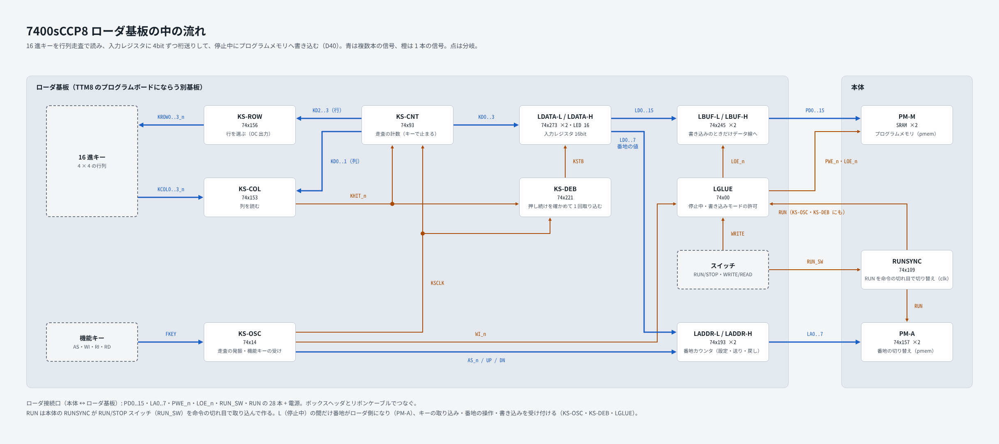
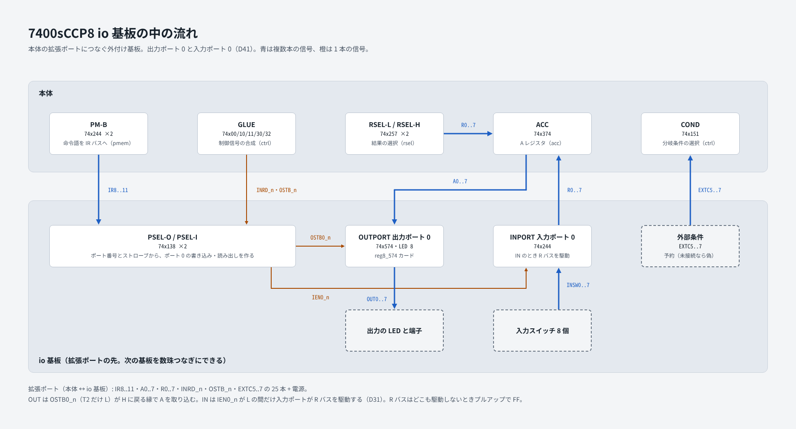

# システム階層の生成物

`scripts/gen_system.py` が `hw/system.json` から作った一覧（`docs/design/generated/README.md`）を取り込んだもの。
生成物の全体図は、同じ内容の閲覧用の図面（Claude Design で作図）に置き換えて載せる。データの流れ・制御の流れ・クロック位相は 4 章の図、ローダ基板と io 基板の中はこの付録の図。

## ローダ基板の中の流れ

<!-- include: docs/design/generated/README.md section="### ローダ基板" lines="キーの行列走査" -->

## io 基板の中の流れ

<!-- include: docs/design/generated/README.md section="### io 基板" lines="拡張ポートの先" -->

## IC 一覧

<!-- include: docs/design/generated/README.md section="## IC 一覧" -->

## 基板とカード

<!-- include: docs/design/generated/README.md section="## 基板とカード" -->

## LED 一覧

<!-- include: docs/design/generated/README.md section="## LED 一覧" -->

## 基板をまたぐ信号

<!-- include: docs/design/generated/README.md section="## 基板をまたぐ信号" -->

## 信号辞書

<!-- include: docs/design/generated/README.md section="## 信号辞書" -->

## 検査結果

<!-- include: docs/design/generated/README.md section="## 検査結果" -->
