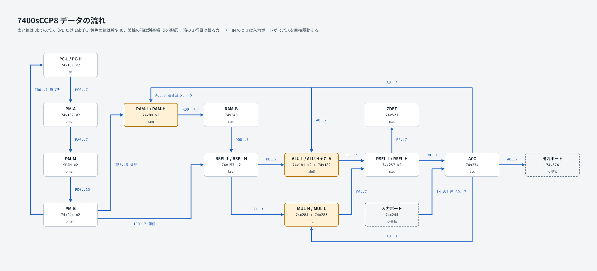
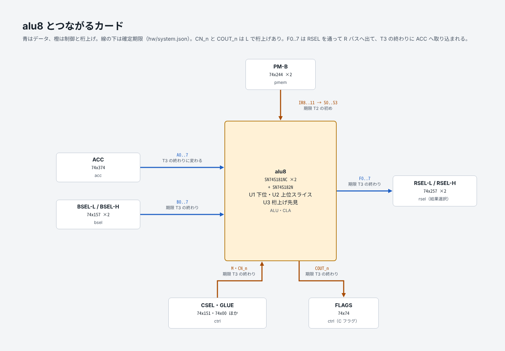
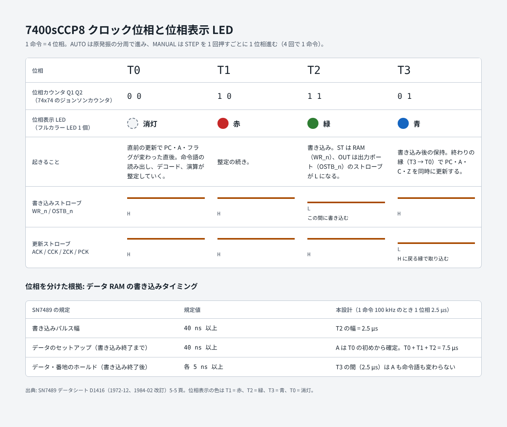

<!-- 公開用資料 alu8 の 2 章（docs/handouts/alu8.json）。表と節は include で正本から取り込み、ここには写さない。組み方は docs/handouts/README.md。 -->

## 2.1 データの流れの中の alu8

alu8 は、A レジスタ（ACC）を左辺、B 入力選択（BSEL）を右辺として演算し、結果 `F0..7` を結果選択（RSEL）へ出します。RSEL を通った結果は R バスに乗り、T3 の終わりに ACC へ取り込まれます。桁上げ出力 `COUT_n` は ctrl カードの C フラグへ行きます。下の図で、黄色の箱は希少 IC を載せるカードです。

## 2.2 命令と ALU の制御

命令語は 16bit で、`IR15..12` が OP、`IR11..8` が FN、`IR7..0` が OPERAND です。ALU を使う命令は OP 0〜9 の 5 組（LOG・ARN・ARP・ARC・TST）で、`M` と `CN_n` は ctrl カードが OP から作ります。

<!-- include: docs/ARCHITECTURE.md section="## 3. 命令セット" lines="- FN は;- C は" -->

ALU を使う命令（`ARCHITECTURE.md` 3 章から）:

<!-- include: docs/ARCHITECTURE.md section="## 3. 命令セット" table=1 rows="0 / 1;2 / 3;4 / 5;6 / 7;8 / 9" -->

制御表のうち ALU を使う行（`SYSTEM.md` 4 章から。T2 のストローブは無く、PC はどれも +1）:

<!-- include: docs/design/SYSTEM.md section="## 4. 制御表" table=1 rows="0 / 1;2 / 3;4 / 5;6 / 7;8 / 9" cols=9 -->

ALU に入る制御信号の論理式（同）:

<!-- include: docs/design/SYSTEM.md section="## 4. 制御表" table=2 rows="`M`;`CN_n`" -->

<!-- include: docs/design/SYSTEM.md section="## 4. 制御表" lines="フラグの持ち方" -->

アセンブラの別名（`ARCHITECTURE.md` 3 章から）:

<!-- include: docs/ARCHITECTURE.md section="## 3. 命令セット" table=2 -->

## 2.3 クロック位相の中の alu8

alu8 は組み合わせ回路です。T3 の終わりに PC・A・C・Z が変わったあと、T0・T1 の間に結果が整定します。alu8 自身の経路の遅延（最大 34 ns）は 3 章の「6. タイミング」にあります。

<!-- include: docs/design/SYSTEM.md section="## 5. クロック位相" table=1 -->

<!-- include: docs/design/SYSTEM.md section="## 5. クロック位相" lines="- `T2` = ;- 状態を持つ素子" -->

<!-- include: docs/design/SYSTEM.md section="### 5.3 74x89" lines="整定時間" -->

## 2.4 電気的な位置づけ

74S181・74S182 は入力電流が大きいので、alu8 の入力につながるネットは、システムの中で重い負荷になります（`SYSTEM.md` 6.2 節）。alu8 の分だけの負荷は 3 章の「5.3」にあります。

<!-- include: docs/design/SYSTEM.md section="### 6.2 重い負荷" table=1 -->

<!-- include: docs/design/SYSTEM.md section="### 6.2 重い負荷" lines="- `IR8..11` を駆動;- `CN_n` を作る;- ALU カードの内部" -->

## 2.5 設計上の論点（`ARCHITECTURE.md` 4 章から）

<!-- include: docs/ARCHITECTURE.md section="## 4. ハードウェア上の論点" lines="- **ゼロ検出**;- **74x182 の使い方**" -->
